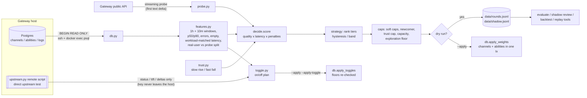

# channel-autoweight

Automatic weight scheduling for the upstream channels of an LLM API gateway.

A gateway usually sends each model family (for example `gpt-*`) to several upstream "channels" (providers or accounts), and splits new sessions between them by weight. Picking those weights by hand does not hold up: upstreams slow down, buffer streams, throw errors, or quietly return empty answers, often within minutes. `channel-autoweight` watches real traffic and active probes, scores every channel, and suggests (or, if you allow it, writes) channel weights. It can also suggest disabling channels that stay bad and re-enabling ones that have recovered.

It is a prototype that runs next to an OpenAI-compatible API gateway and reads the `channels`, `abilities` and `logs` tables of the gateway's Postgres database. It is pure Python standard library plus `requests`, and it has no long-running server.

> Status: research prototype (v2.02). The interfaces are CLI scripts. Every threshold is in `config.json`.

## Principles

1. **Default distrust.** A channel earns traffic with evidence. New or re-enabled channels start with low trust and a weight cap until they have served enough *real* user requests. Probe traffic alone never makes a channel the leader.
2. **Slow trust gain, fast cut.** Bad news (errors, buffering, slow requests, failed probes) acts immediately: trust is multiplied down, the 10-minute error factor kicks in, and the weight drops in the same round. Good news is discounted by sample size and has to repeat before trust and weight rise.
3. **Probability over point estimates.** Small samples are noisy, so the system works with posteriors and confidence. Tools include shrinkage, sample-size-adaptive window weights, a buffering probability (Beta posterior), bootstrap `P(best)`, and evidence thresholds. The aim is to avoid flipping weights on noise.
4. **Read-only by default.** Collection, scoring, the shadow mode and every diagnostic tool run inside `BEGIN READ ONLY` transactions. Writes happen only through two explicit paths, described below.

## How it works



Each **round** (`run.py`) does the following:

1. **Collect.** Read the enabled channels that serve the target model family, plus logs from the last 60+10 minutes, using a read-only query.
2. **Probe.** Send one short streaming request per channel through the public gateway. The first-token time is when the first non-empty text delta arrives. A probe is rechecked when it is an outlier, and recent probes can be reused.
3. **Features.** For the 1h and 10m windows: request count, p50/p90 latency, slow rate, error rate (client errors made by the user can be excluded), empty-success rate, concurrency, output-token size, workload-matched latency ratio, and real-traffic first token. Probe-token rows are separated from real users.
4. **Trust.** Update each channel's trust from this round's bad events.
5. **Score, strategy, caps.** These produce the target weights, explained in the sections below.
6. **Record.** Append to `data/rounds.jsonl`. With `--apply`, write the weights. `verify.py` then checks the write.

The **shadow mode** (`shadow.py`) runs the same pipeline every 5 minutes. It never writes. It probes only channels with too little real traffic, carries trust forward on its own, and backfills gaps after the host was asleep. Its output, `data/shadow.jsonl`, is what the review and replay tools evaluate.

## Scoring

For each window *w* (1h and 10m):

```
score_w = (1 - err)^err_exp * (1 - slow) * t_ref / (t_ref + a*p50 + b*p90 + c*ttft)
```

- `p50/p90` are blended with workload-matched values (`score.workload_match`). This way a channel that only got short jobs does not look fast.
- `ttft` blends the probe first token with the real first token from the logs (`score.log_ttft`). The more log samples there are, the more the log value is trusted.
- The 10m window is blended in with weight `w_10m`. When 10m is worse than 1h it gets full weight (bad news acts at once). When 10m is better, the weight is discounted by sample size.
- **Multipliers:** a 10m error burst factor `(1-err_10m)^2`; a sudden-slowdown factor (10m normalised latency far above peers); a non-streaming penalty, applied unless real streaming traffic in the logs vetoes the probe's "buffered" verdict; and a penalty when every probe failed.
- **Trust:** `score *= floor + (1 - floor) * trust`.

## Tier mapping

The default `rank` strategy maps each channel's score ratio to the leader, `r = score / top_score`, onto a weight tier:

| Condition | Weight (default) |
|---|---|
| all channels within `tie_ratio` (0.95) of each other | uniform |
| leader | `top_w` = 12 |
| r >= `close_ratio` (0.85) | `top_w * close_factor` = 9.6 |
| r >= `mid_ratio` (0.7) | `mid_w` = 3 |
| otherwise | `low_w` = 0 |

Weights are kept within `w_min..w_max` (0..20). There are also optional stabilisers, all of which can be switched on in the config:

- leader hysteresis
- tier hysteresis (`band`)
- continuous tiers (`ramp`)
- co-leaders
- low-traffic tier parameters
- trusted-leader reference
- asymmetric score smoothing
- rise confirmation

A `proportional` strategy (weight proportional to `score^gamma`) is included for comparison.

## Caps

After the strategy runs, caps are applied. A truncated channel is pinned at its cap and the strategy reruns on the remaining channels, so the "best channel" slot goes to the next one.

- **Soft caps** (`soft_caps`): a per-channel cap with a reason, such as a known quality risk. Optionally the cap is relaxed when the channel is clean on every quality check.
- **Newcomer cap** (`newcomer`): channels are discovered from the DB automatically. A channel counts as new if it has appeared in fewer than `min_rounds` formal write rounds, or if no formal round has yet shown `graduate_real_n60` real 1h requests. A new channel with fewer than `min_real_n60` (30) real user requests in 1h gets at most `cap` (6). Probe requests do not count. A new channel with zero errors gets at least `explore_w` (2), so it is not starved of the traffic it needs to prove itself.
- **Trust cap** (`trust_cap`): a channel with trust below `thr` and a small 1h sample gets at most `cap` until its trust recovers.
- **Capacity cap** (`capacity`): for a channel with a known concurrency limit, the weight is limited so that its share of the estimated peak concurrency stays within the limit.
- **Recovery and small-sample caps**: optional.

## On/off rules (`toggle.py`)

The system only suggests and records actions. They are executed with `run.py --apply --apply-toggle`, after review.

- **Re-enable.** Each round, every disabled channel is tested `n_test` times directly against its own upstream from the gateway host. A round passes when all of these hold:
  - every request succeeds;
  - the response really streams (at least 2 deltas over a span greater than 0);
  - the first token and the total time both beat the bottom-third baseline of the enabled channels.

  After `need_streak` (3) consecutive passing rounds, the system suggests re-enabling the channel at `start_weight` (2).
- **Disable, rank-based.** A channel that ranks last among channels with enough real traffic for `last_rounds` (5) formal rounds, spanning at least `last_span_min` (210) minutes, is suggested for disabling. This never happens while only `min_enabled` (4) channels or fewer are enabled.
- **Disable, persistent errors.** A channel that is already at weight 0 and still has a 1h error rate of at least 20% for 2 rounds can be disabled down to `hard_min` (3) enabled channels. Failed probe rounds count towards this.
- **Floors.** The system never goes below `hard_min` enabled channels. The floor is checked again inside the write transaction.

## Safety model

- **Shadow mode first.** `shadow.py` computes suggestions every 5 minutes without writing anything. Review tools (`evaluate.py --shadow`, `tools/shadow_replay.py`, `tools/override_eval.py`) compare the suggestions with what real traffic did afterwards, before anyone trusts the system to write.
- **Read-only queries.** Every read is wrapped in `BEGIN READ ONLY ... COMMIT`. The diagnostic tools never connect with write intent.
- **Two write paths only.**
  - `db.apply_weights` updates `channels.weight/priority` for enabled channels, then syncs `abilities` from `channels` in the same transaction. The gateway routes on `abilities`, so updating `channels` alone would have no effect.
  - `db.apply_toggles` changes `status` together with the matching `abilities` rows. The floors are checked again before it writes.
- **Guard rails on writes.** The default is a dry run.
  - `--final` must list every adjustable channel.
  - `--expect-system` aborts the write when the recomputed suggestion drifted since the dry run, but only for channels whose final value follows the system.
  - `verify.py` checks afterwards that `channels` and `abilities` agree.
- **Secrets.**
  - The probe key comes from `AUTOWEIGHT_PROBE_KEY` or a key file. It is never logged.
  - The direct upstream test runs on the gateway host. The upstream key stays in that remote process and is masked in any error text.
  - Outputs contain only status codes and timings.

## Layout

```
autoweight/      core package: db, features, decide, trust, shadow, toggle, probe, upstream, watch, diag, verify, config
run.py           one formal round (dry run by default; --apply writes)
shadow.py        shadow mode (read-only, every 5 min)
backtest.py      hour-by-hour backtest on logs or a saved snapshot
evaluate.py      effect evaluation of formal rounds
evaluate_shadow.py  shadow review logic (used by evaluate.py --shadow)
verify.py        post-write consistency check
report_table.py  Markdown report of a round
tools/           read-only diagnostics and replay tools (shadow_replay, pbest, share_audit, error_timeline, ...)
examples/        synthetic snapshot generator for offline backtests
tests/           unit tests (stdlib unittest) + synthetic fixtures
docs/            changelog
```

## Setup

Requirements:
- Python 3.10+ and `requests`.
- For live use: ssh access to the gateway host, and a Postgres container there that has `psql`.

```bash
pip install requests
cp config.example.json config.json      # config.json is git-ignored
# fill in the placeholders, or use environment variables:
export AUTOWEIGHT_SSH_HOST=my-gateway-host
export AUTOWEIGHT_PG_CONTAINER=my-postgres
export AUTOWEIGHT_PROBE_BASE_URL=https://gateway.example.com
export AUTOWEIGHT_PROBE_MODEL=my-model
export AUTOWEIGHT_PROBE_KEY=...         # probe API key; never put it in config.json
```

Set `probe_token_ids` to the token id(s) that the probe key uses. This keeps probe traffic out of the real-user metrics.

## Running

```bash
python3 run.py                         # dry run: collect, probe, decide, record
python3 run.py --compare               # also show every strategy
python3 run.py --apply --final 1=12,2=10,3=3 --expect-system 1=12,2=10,3=3 --reason "reviewed"
python3 verify.py                      # check channels/abilities after a write

python3 shadow.py                      # one shadow point (read-only)
tools/shadowctl.sh start|stop|status   # shadow loop every 5 minutes
python3 evaluate.py --shadow --since 60m  # review the last hour of shadow suggestions
```

## Tests

```bash
python3 -m unittest discover -s tests
```

The tests use synthetic data only, with `tests/fixtures/config.test.json` as the config. They need neither a database nor network access.

## Backtest and replay

```bash
# offline backtest on synthetic data
python3 examples/make_synthetic_snapshot.py --out /tmp/snap.json
python3 backtest.py --config config.example.json --load /tmp/snap.json --hours 24
python3 backtest.py --config config.example.json --load /tmp/snap.json --sweep strategies.rank.close_ratio=0.8,0.85,0.9

# against your own gateway (read-only): pull once, then A/B on the same snapshot
python3 backtest.py --hours 24 --align-hour --dump data/snap.json
python3 backtest.py --load data/snap.json --set score.w_10m=0.3

# replay recorded shadow points with changed parameters
python3 tools/shadow_replay.py --since-hours 6 --sweep strategies.rank.band=0,0.03,0.05 --evolve-trust --matched
```

The project's rule for changing a default is that the new value must replay better on recent shadow data over several horizons (3h/6h/12h/24h), measured by traffic-weighted p50/p90, error rate, and workload-matched latency. Most experimental features ship switched off. `docs/CHANGELOG.md` records which ones were enabled.

## License

MIT, see [LICENSE](LICENSE).
